# AtlasRoute: sınıf, kullanım durumu ve sıra diyagramları

Kaynaklar bu klasördeki `.mmd` dosyalarıdır; bu sayfa ve `../AtlasRoute-Diyagramlar.pdf` onlardan
`node docs/diagrams/pdf.mjs` ile üretilir. `tests/design.lua` diyagramları kodla karşılaştırır.

## Paketler

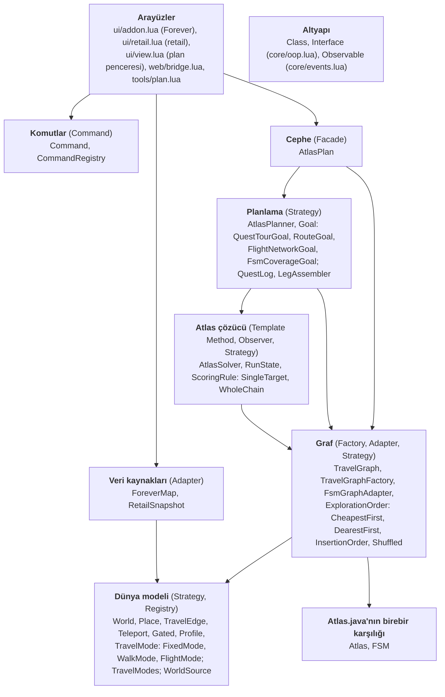

## 1. Dünya modeli

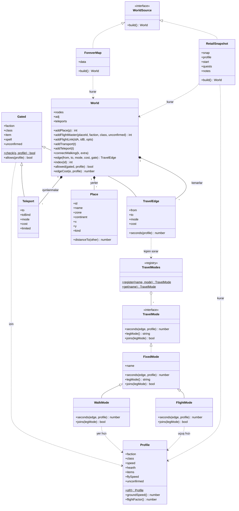

## 2. Graf ve Atlas çözücü

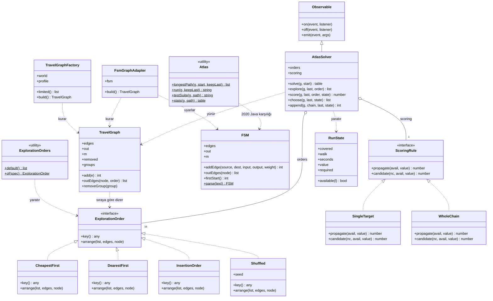

## 3. Planlama, cephe ve arayüzler

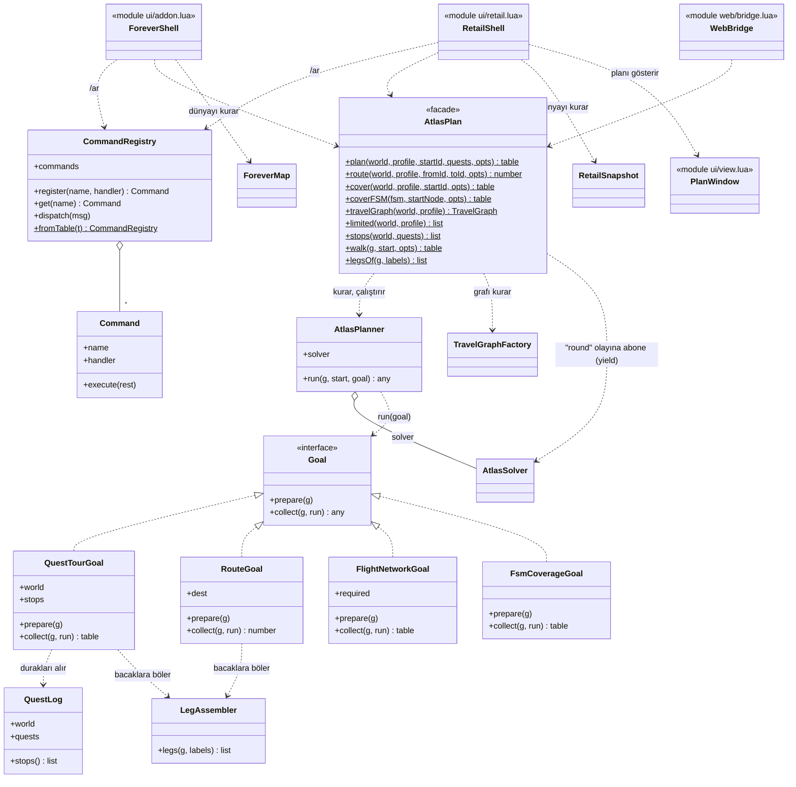

## 4.1 Kullanım durumları: Forever eklentisi

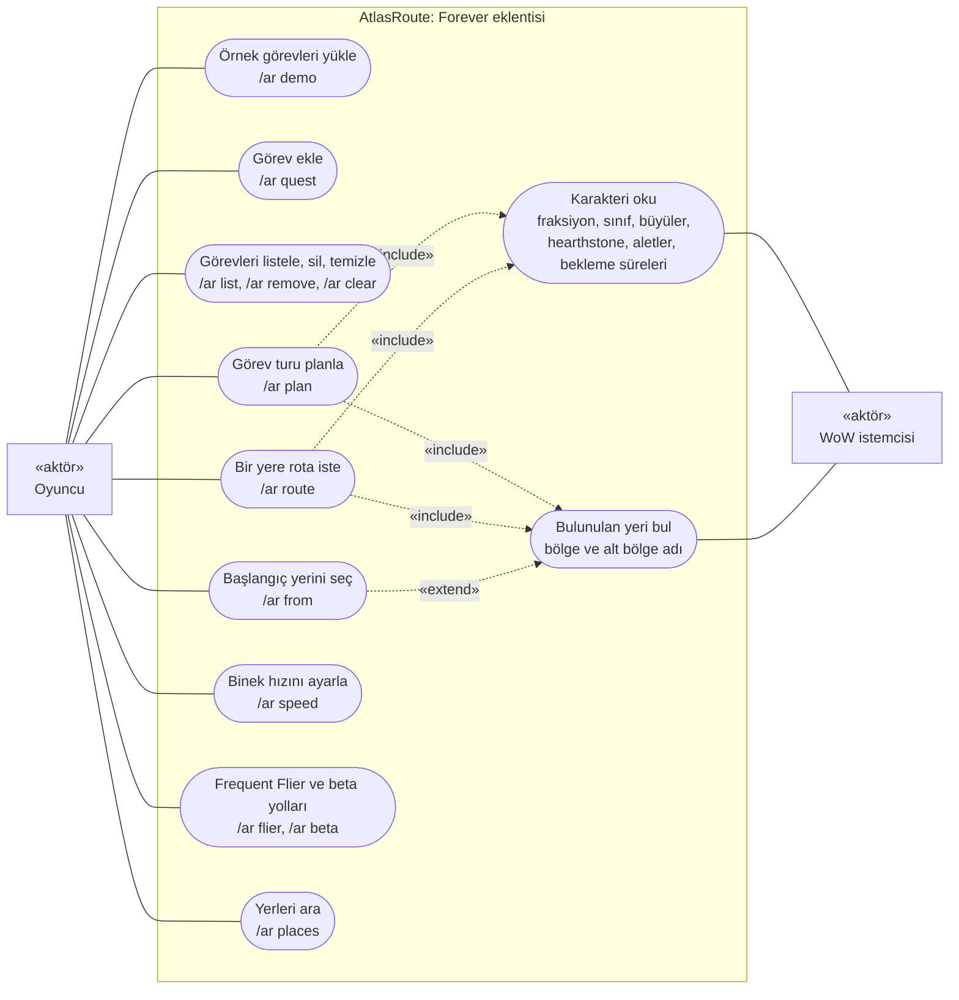

## 4.2 Kullanım durumları: retail eklentisi

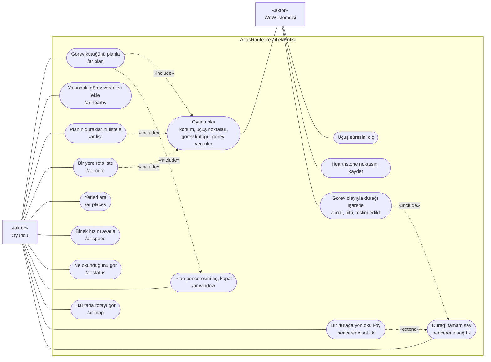

## 4.3 Kullanım durumları: tanıtım sayfası

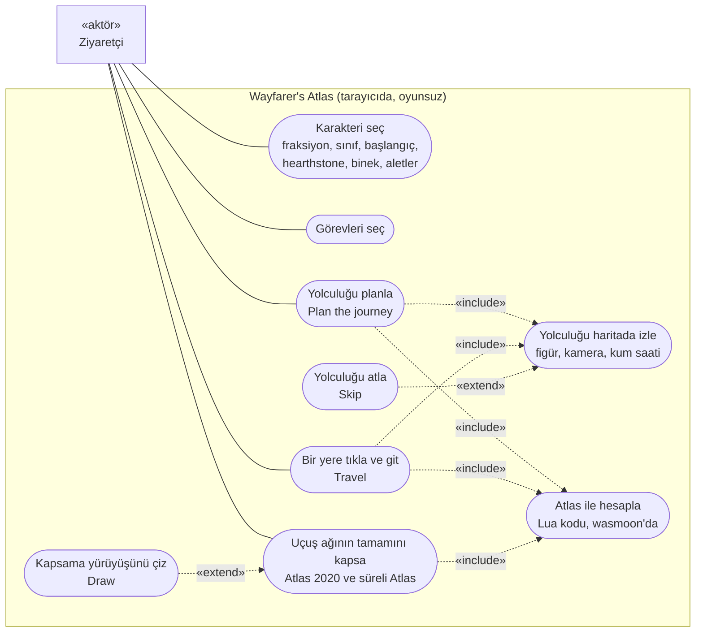

## 5.1 Sıra: Forever eklentisinde /ar plan

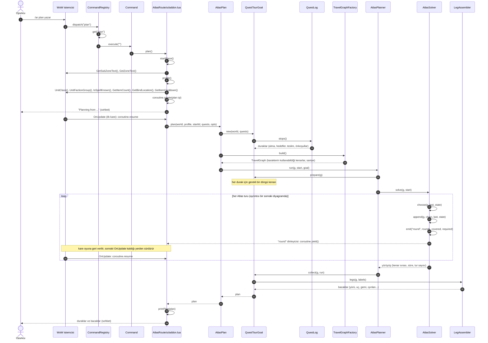

## 5.2 Sıra: bir Atlas turu

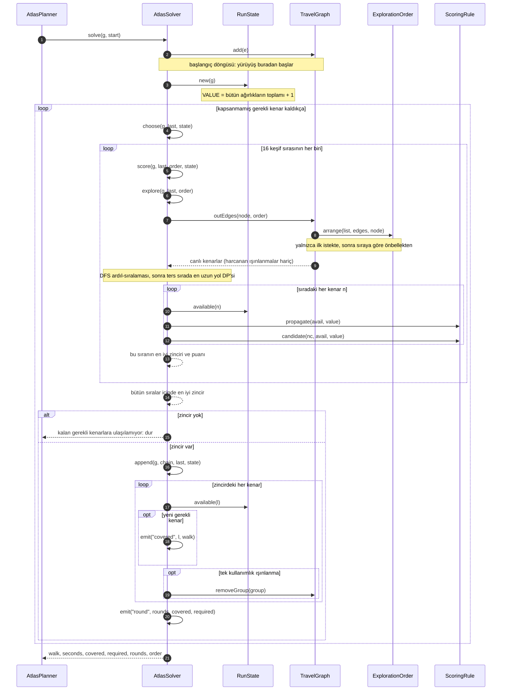

## 5.3 Sıra: retail eklentisinde /ar plan ve bir görev olayı

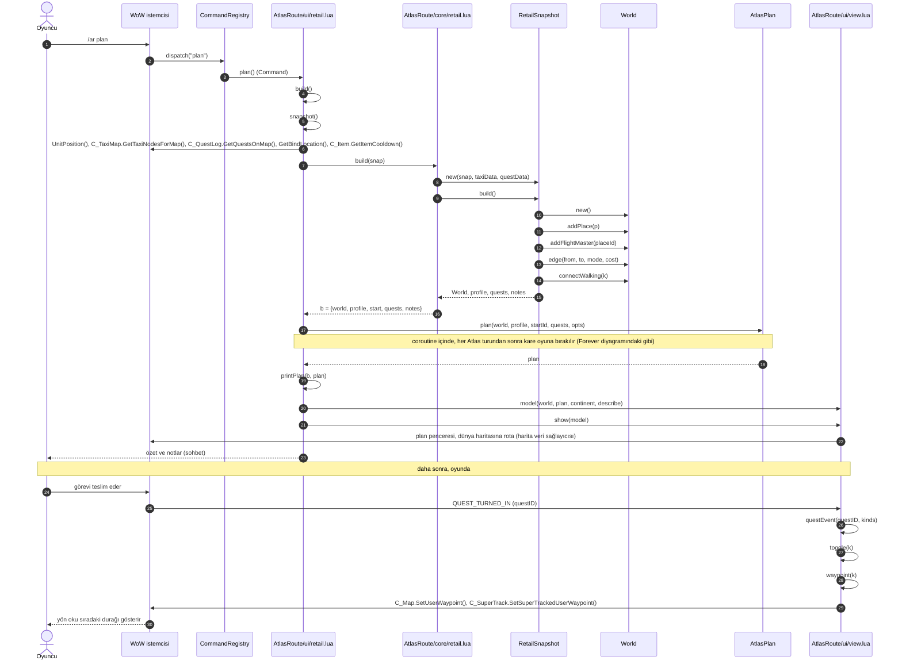

## 5.4 Sıra: tanıtım sayfasında plan

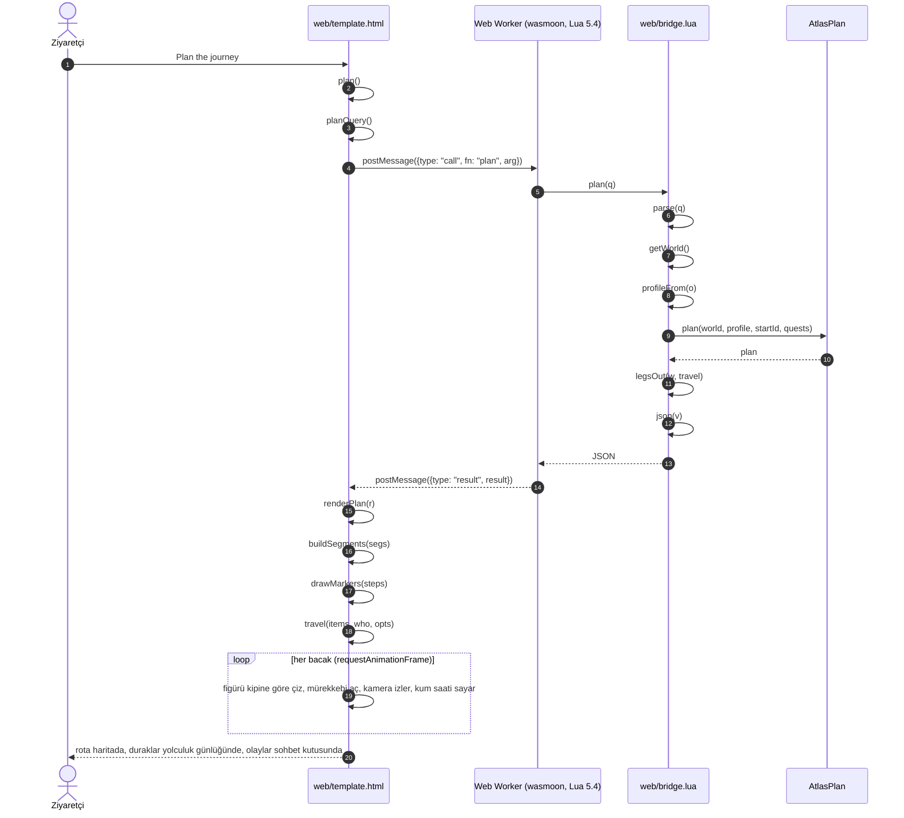
