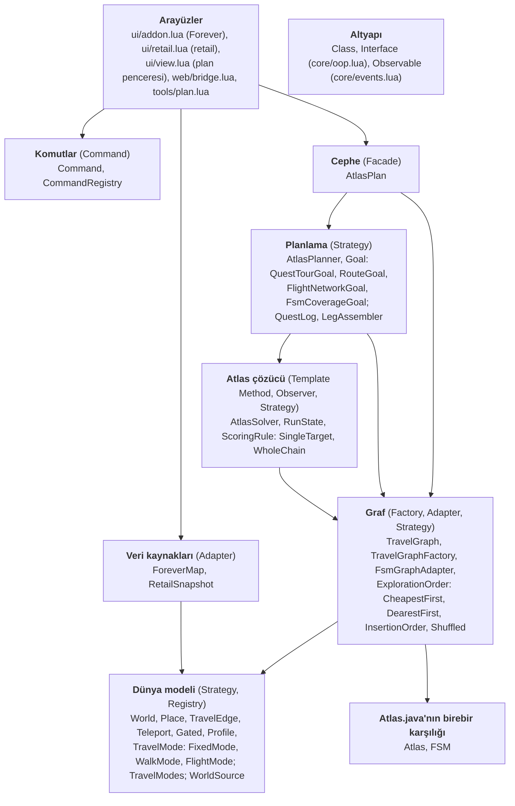
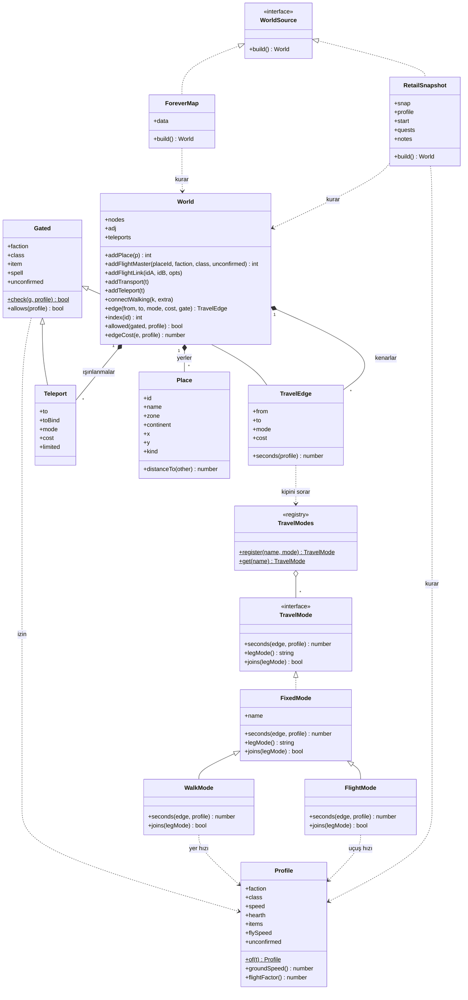
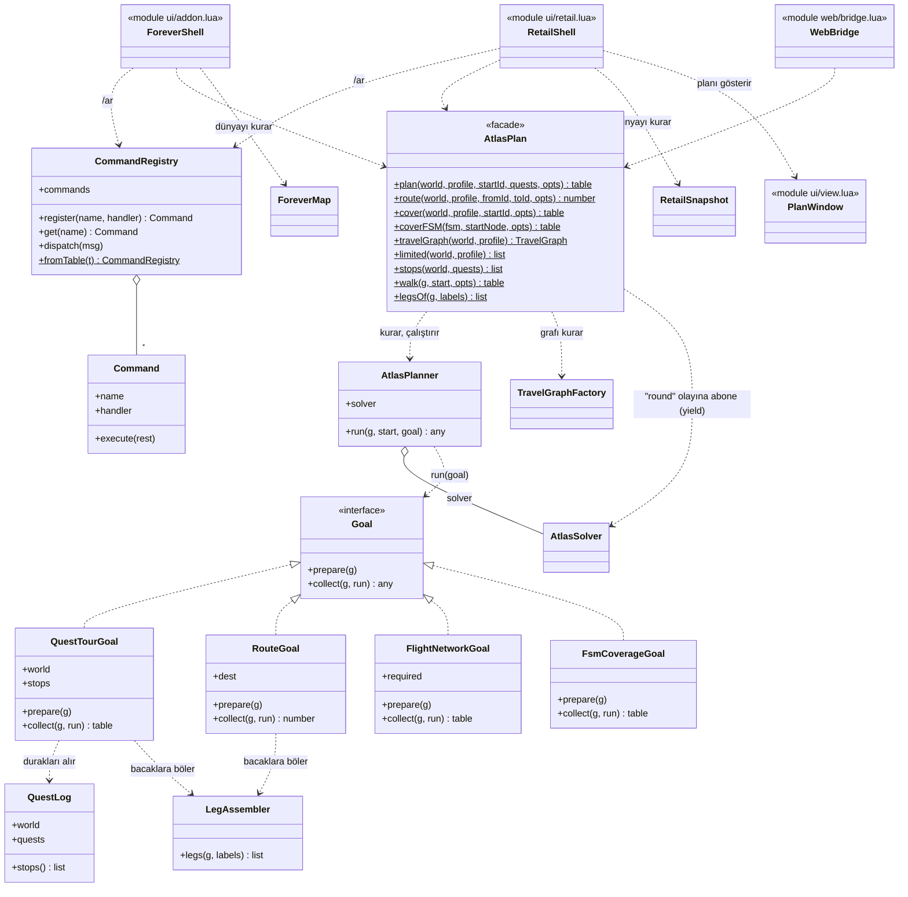

# AtlasRoute: sınıf diyagramları

Kaynaklar bu klasördeki `.mmd` dosyalarıdır; bu sayfa ve `../AtlasRoute-Sinif-Diyagramlari.pdf` onlardan
`node docs/diagrams/pdf.mjs` ile üretilir. `tests/design.lua` diyagramları kodla karşılaştırır.

## Paketler

## 1. Dünya modeli

## 2. Graf ve Atlas çözücü

## 3. Planlama, cephe ve arayüzler

